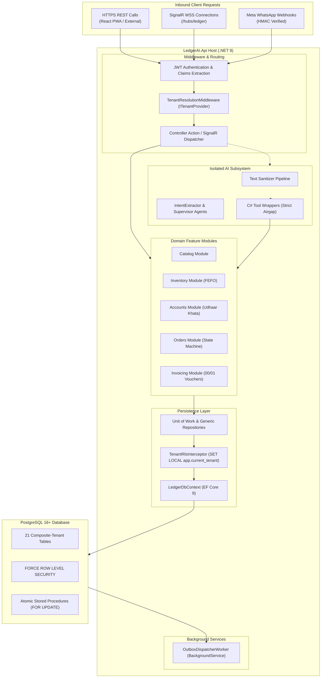
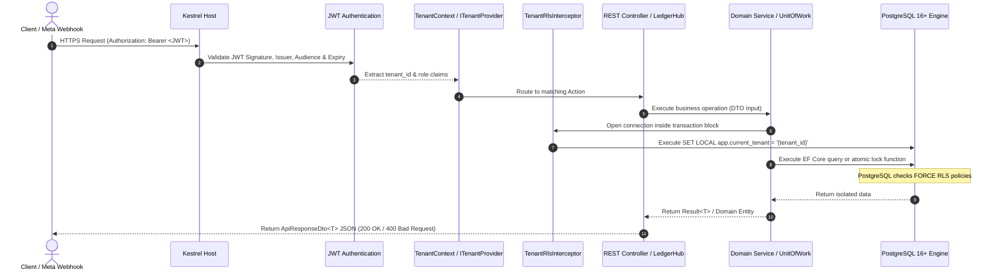
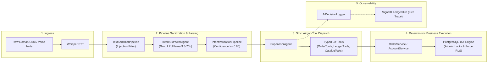

# LedgerAI.Api: .NET 9 Modular Monolith Backend & AI Web API

[](https://dotnet.microsoft.com/)
[](https://www.postgresql.org/)
[](https://learn.microsoft.com/en-us/ef/core/)
[](https://scalar.com/)
[](../LICENSE)

The official backend service for **LedgerAI** — a multi-tenant B2B wholesale Enterprise Resource Planning (ERP), inventory management engine, and digital *Udhaar Khata* (credit ledger). Engineered in C# 13 on `.NET 9`, this project encapsulates deterministic transactional accounting, PostgreSQL 16+ Row-Level Security (RLS), and an isolated multi-agent AI pipeline for natural language order intake.

---

## Table of Contents
1. [Backend Architectural Overview](#1-backend-architectural-overview)
2. [HTTP Middleware & Request Pipeline](#2-http-middleware--request-pipeline)
3. [Source Code Hierarchy & Organization](#3-source-code-hierarchy--organization)
4. [Domain Feature Modules](#4-domain-feature-modules)
5. [Persistence Layer & Strict DTO Separation](#5-persistence-layer--strict-dto-separation)
6. [Multi-Agent AI Orchestration & Tool-Calling Airgap](#6-multi-agent-ai-orchestration--tool-calling-airgap)
7. [External Communication & Background Workers](#7-external-communication--background-workers)
8. [API Endpoints, Webhooks & SignalR Hubs](#8-api-endpoints-webhooks--signalr-hubs)
9. [Configuration & Environment Variables](#9-configuration--environment-variables)
10. [Local Build, Run & Verification Guide](#10-local-build-run--verification-guide)

---

## 1. Backend Architectural Overview

`LedgerAI.Api` is designed as a **Single-Project Modular Monolith**. It groups domain logic, entities, calculators, and services into discrete bounded business contexts (`src/Modules/`), while housing shared persistence abstractions in `src/Data/`, cross-cutting security and global primitives in `src/Core/`, and isolated AI agent workflows in `src/AI/`.



---

## 2. HTTP Middleware & Request Pipeline

Every incoming HTTP request traverses a hardened middleware pipeline:



---

## 3. Source Code Hierarchy & Organization

All source code lives inside `src/` inside the `LedgerAI.Api` project root:

```text
LedgerAI.Api/
├── LedgerAI.Api.csproj                         # .NET 9 Web API project file
├── LedgerAI.Api.sln                            # Visual Studio solution file
├── Program.cs                                  # Kestrel bootstrapping, DI container & middleware wiring
├── appsettings.json                            # Base configuration templates
├── appsettings.Development.json                # Local development settings (ignored by Git)
├── Properties/
│   └── launchSettings.json                     # Port 7274 (HTTPS) & Port 5284 (HTTP)
│
└── src/
    ├── Core/                                   # Cross-Cutting Concerns & Domain Primitives
    │   ├── Common/                             # BaseEntity, Result<T>, PagedResult<T>, DomainException
    │   ├── Interfaces/                         # IRepository<T>, IUnitOfWork, ITenantProvider
    │   ├── Security/                           # JwtSettings, TenantContext, AppRoles
    │   └── Enums/                              # OrderStatus, AccountType, InvoiceType, RiskTier, PaymentTerms, etc.
    │
    ├── Data/                                   # Persistence Layer & Strict DTO Separation
    │   ├── Context/                            # LedgerDbContext.cs (21 DbSets & ModelBuilder configuration)
    │   ├── Configurations/                     # Fluent API configuration folder
    │   ├── Repositories/                       # Generic Repository<T> EF Core implementation
    │   ├── UnitOfWork/                         # UnitOfWork.cs managing EF Core ACID transactions
    │   ├── Interceptors/                       # TenantRlsInterceptor.cs (PostgreSQL RLS connection hook)
    │   ├── Migrations/                         # EF Core Code-First migration output
    │   ├── Seeders/                            # DbSeeder.cs shell for baseline tenant data
    │   └── Dtos/                               # Strictly decoupled Request/Response contracts
    │       ├── Common/                         # ApiResponseDto.cs
    │       ├── Catalog/                        # CategoryDto, UnitOfMeasureDto, ProductDto
    │       ├── Inventory/                      # WarehouseDto, StockBatchDto, StockMovementDto
    │       ├── Accounts/                       # AccountDto, LedgerEntryDto, PaymentAllocationDto
    │       ├── Orders/                         # OrderDto, CreateOrderDto
    │       ├── Invoicing/                      # InvoiceDto, CreateInvoiceDto
    │       └── AI/                             # NormalizedIntentDto, AiDecisionLogDto
    │
    ├── Modules/                                # Bounded Domain Feature Modules
    │   ├── TenantAdmin/                        # Tenant.cs, User.cs, ITenantService, TenantService
    │   ├── Catalog/                            # Category.cs, UnitOfMeasure.cs, Product.cs, ICatalogService, CatalogService
    │   ├── Inventory/                          # Warehouse.cs, StockItem.cs, StockBatch.cs, StockMovement.cs, StockReservation.cs
    │   ├── Accounts/                           # Account.cs, LedgerEntry.cs, LedgerAllocation.cs, IAccountService, AccountService
    │   ├── Orders/                             # Order.cs, OrderItem.cs, IOrderService, OrderService
    │   ├── Invoicing/                          # Invoice.cs, InvoiceItem.cs, InvoiceCharge.cs, IInvoiceService, InvoiceService
    │   └── Operations/                         # InboundMessage.cs, OutboxEvent.cs, AuditLog.cs
    │
    ├── AI/                                     # Multi-Agent AI Orchestration Subsystem
    │   ├── Agents/                             # IntentExtractorAgent, SupervisorAgent, OrderAgent, LedgerAgent
    │   ├── Tools/                              # OrderTools, LedgerTools, CatalogTools (Strict Airgap C# Wrappers)
    │   ├── Pipelines/                          # TextSanitizerPipeline, IntentValidationPipeline
    │   ├── Monitoring/                         # IAiTelemetryService, AiDecisionLogger (SignalR live trace)
    │   ├── Prompts/                            # IntentExtractionPrompt.txt (bilingual prompt templates)
    │   └── Routers/                            # LlmFailoverRouter (Groq LPU -> HuggingFace fallback)
    │
    ├── Communication/                          # External Messaging & Asynchronous Workers
    │   ├── WhatsApp/                           # WhatsAppClient (HttpClient), WebhookSignatureVerifier
    │   └── Workers/                            # OutboxDispatcherWorker (BackgroundService)
    │
    └── Api/                                    # Presentation Layer
        ├── Controllers/                        # SystemMetadataController, Catalog, Inventory, Accounts, Orders, Invoices, AiChat
        ├── Webhooks/                           # WhatsAppWebhookController (Meta ingress & verification)
        └── Hubs/                               # LedgerHub (SignalR WebSocket hub for UI telemetry & alerts)
```

---

## 4. Domain Feature Modules

| Module | Core Entities | Responsibilities & Capabilities |
| :--- | :--- | :--- |
| **`TenantAdmin`** | `Tenant`, `User` | Tenant isolation root, onboarding, user provisioning, and 5-tier RBAC (`Owner`, `Admin`, `Manager`, `Operator`, `Viewer`). |
| **`Catalog`** | `Category`, `UnitOfMeasure`, `Product` | Master catalog, two-tier UOM conversions (`Base` + `Secondary` pack), fractional constraints, and JSONB Roman Urdu aliases. |
| **`Inventory`** | `Warehouse`, `StockItem`, `StockBatch`, `StockMovement`, `StockReservation` | Multi-warehouse FEFO batch tracking, atomic order reservations (`fn_reserve_batch_stock`), and trigger-maintained aggregate stock. |
| **`Accounts`** | `Account`, `LedgerEntry`, `LedgerAllocation` | Unified party register (`CUSTOMER`, `SUPPLIER`, `TRANSPORTER`), *Udhaar Khata* running balances, single-reversal entries, and automated FIFO payment allocation. |
| **`Orders`** | `Order`, `OrderItem` | B2B sales order state machine (`PENDING_APPROVAL`, `VALIDATED`, `COMMITTED`, `REJECTED`, `CANCELLED`), confidence scoring, and credit limit exposure checks. |
| **`Invoicing`** | `Invoice`, `InvoiceItem`, `InvoiceCharge` | Dual-series vouchers (`00` Purchase / `01` Sale), landed cost proration into WAC, stock commits, and localized wholesale charges (`Bilty`, `Mazdoori`, `WHT`, `Kasar`). |
| **`Operations`** | `InboundMessage`, `OutboxEvent`, `AuditLog` | Inbound WhatsApp payload logging with `wamid` deduplication, Transactional Outbox event queue, and immutable audit trails. |

---

## 5. Persistence Layer & Strict DTO Separation

### Entity-DTO Decoupling Standard
Internal EF Core entity models (`src/Modules/*/Entities`) are strictly decoupled from external consumers:
* **Controllers & Hubs** only accept and return strongly typed DTOs (`src/Data/Dtos/*`).
* **Entities** are never serialized directly into HTTP responses, preventing accidental leakage of internal keys, password hashes, or sensitive financial state.

### PostgreSQL Row-Level Security Connection Interceptor
The `TenantRlsInterceptor` hooks into EF Core's connection lifecycle:
```csharp
public override async Task ConnectionOpenedAsync(
    DbConnection connection,
    ConnectionEndEventData eventData,
    CancellationToken cancellationToken = default)
{
    var tenantId = _tenantProvider.GetCurrentTenantId();
    if (tenantId.HasValue && tenantId.Value != Guid.Empty)
    {
        await using var command = connection.CreateCommand();
        command.CommandText = $"SET LOCAL app.current_tenant = '{tenantId.Value}';";
        await command.ExecuteNonQueryAsync(cancellationToken);
    }
    await base.ConnectionOpenedAsync(connection, eventData, cancellationToken);
}
```

---

## 6. Multi-Agent AI Orchestration & Tool-Calling Airgap

The AI subsystem operates in a secure sandbox isolated from direct database access:



* **No Raw SQL / No DbContext:** Agents invoke typed methods in `src/AI/Tools/`, which invoke domain services (`IOrderService`, `IAccountService`).
* **Resilience & Key Rotation:** `LlmFailoverRouter` (backed by Polly v8) rotates Groq API keys on HTTP `429` rate limits and falls back to HuggingFace on timeouts.
* **Human-in-the-Loop Gating:** If `ai_confidence_score < 0.85` or the customer breaches their `credit_limit`, the order is flagged `requires_approval = true` with status `PENDING_APPROVAL`.

---

## 7. External Communication & Background Workers

### Meta WhatsApp Cloud API Client
* **Inbound:** Handled via `WhatsAppWebhookController` at `/api/webhooks/whatsapp`. Inbound payloads are verified using HMAC-SHA256 (`WebhookSignatureVerifier`) and deduplicated via unique `wamid` idempotency keys.
* **Outbound:** `WhatsAppClient` handles outbound template notifications and interactive order confirmation messages.

### Transactional Outbox Background Worker
`OutboxDispatcherWorker` runs as an ASP.NET Core `BackgroundService`:
1. Periodically polls the `outbox_events` table for unprocessed events (`WHERE processed_at IS NULL AND available_at <= now()`).
2. Dispatches notifications (SignalR alerts, WhatsApp confirmation messages).
3. Marks events as processed or applies exponential backoff on transient failure.
4. Ensures database transactions commit reliably without distributed 2-phase commit overhead.

---

## 8. API Endpoints, Webhooks & SignalR Hubs

### Summary of REST Endpoints

| Area | HTTP Method | Endpoint | Description |
| :--- | :---: | :--- | :--- |
| **System** | `GET` | `/api/metadata` | Health, version, environment, and database engine status. |
| **System** | `GET` | `/health` | ASP.NET Core health check endpoint. |
| **Catalog** | `GET` | `/api/catalog/products` | Retrieve active products with pricing and UOM details. |
| **Inventory**| `GET` | `/api/inventory/warehouses` | List active godowns/warehouses. |
| **Accounts** | `GET` | `/api/accounts` | Query party registers, current balances, and risk tiers. |
| **Orders** | `GET` | `/api/orders` | Retrieve wholesale sales orders and approval states. |
| **Invoicing**| `GET` | `/api/invoices` | List dual-series purchase (`00`) and sale (`01`) invoices. |
| **AI Chat** | `POST` | `/api/aichat/message` | Ingest informal natural language text for intent extraction. |
| **Webhooks** | `GET` | `/api/webhooks/whatsapp` | Meta Cloud API webhook subscription challenge verification. |
| **Webhooks** | `POST` | `/api/webhooks/whatsapp` | Inbound WhatsApp messages, voice notes, and delivery receipts. |
| **SignalR** | `WSS` | `/hubs/ledger` | Live WebSocket hub for ERP stock changes and AI decision logs. |

### Interactive Documentation
* **Scalar Interactive UI:** `http://localhost:5284/scalar/v1` (or `https://localhost:7274/scalar/v1`)
* **OpenAPI 3.x Document:** `http://localhost:5284/openapi/v1.json`

---

## 9. Configuration & Environment Variables

Configure application settings in `appsettings.json` or `appsettings.Development.json`:

```json
{
  "Logging": {
    "LogLevel": {
      "Default": "Information",
      "Microsoft.AspNetCore": "Warning",
      "Microsoft.EntityFrameworkCore.Database.Command": "Information"
    }
  },
  "AllowedHosts": "*",
  "ConnectionStrings": {
    "DefaultConnection": "Host=localhost;Port=5432;Database=ledgerai_db;Username=postgres;Password=YourPassword;Include Error Detail=true;"
  },
  "JwtSettings": {
    "Secret": "YourSuperSecretKeyWithAtLeast32BytesLengthPlaceholder!",
    "Issuer": "LedgerAI.Api",
    "Audience": "LedgerAI.Clients",
    "ExpiryMinutes": 120
  },
  "GroqSettings": {
    "ApiKey": "gsk_YourGroqApiKeyPlaceholder",
    "BaseUrl": "https://api.groq.com/openai/v1",
    "PrimaryModel": "llama-3.3-70b-versatile",
    "FallbackModel": "mixtral-8x7b-32768",
    "TimeoutSeconds": 30
  },
  "WhatsAppSettings": {
    "ApiVersion": "v20.0",
    "PhoneNumberId": "YOUR_PHONE_NUMBER_ID",
    "AccessToken": "YOUR_WHATSAPP_PERMANENT_ACCESS_TOKEN",
    "WebhookVerifyToken": "YOUR_CUSTOM_VERIFY_TOKEN",
    "AppSecret": "YOUR_APP_SECRET"
  }
}
```

---

## 10. Local Build, Run & Verification Guide

### Prerequisites
* [.NET 9 SDK](https://dotnet.microsoft.com/download/dotnet/9.0)
* [PostgreSQL 16+](https://www.postgresql.org/) (Local instance or Supabase)

### Build & Execution Commands

```bash
# 1. Navigate to the API root
cd LedgerAI.Api

# 2. Restore NuGet dependencies
dotnet restore

# 3. Compile the solution (0 Warnings, 0 Errors)
dotnet build

# 4. Run the API under the local Kestrel profile
dotnet run --launch-profile http
```

### Verification Endpoints
Once running, verify the backend via curl or browser:

```bash
# 1. System Metadata Check
curl -s http://localhost:5284/api/metadata

# 2. ASP.NET Core Health Probe
curl -s http://localhost:5284/health

# 3. Scalar API Interactive Documentation
open http://localhost:5284/scalar/v1
```

---

## License

This project is licensed under the [MIT License](../LICENSE).
